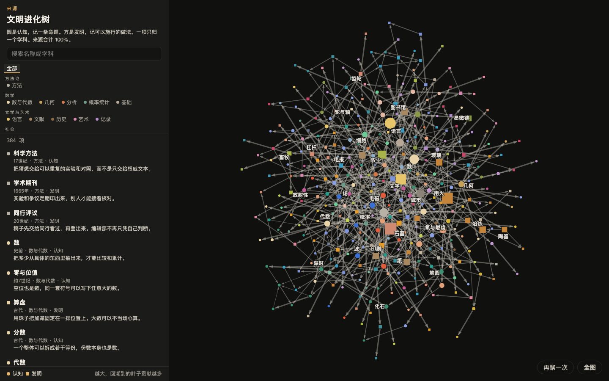
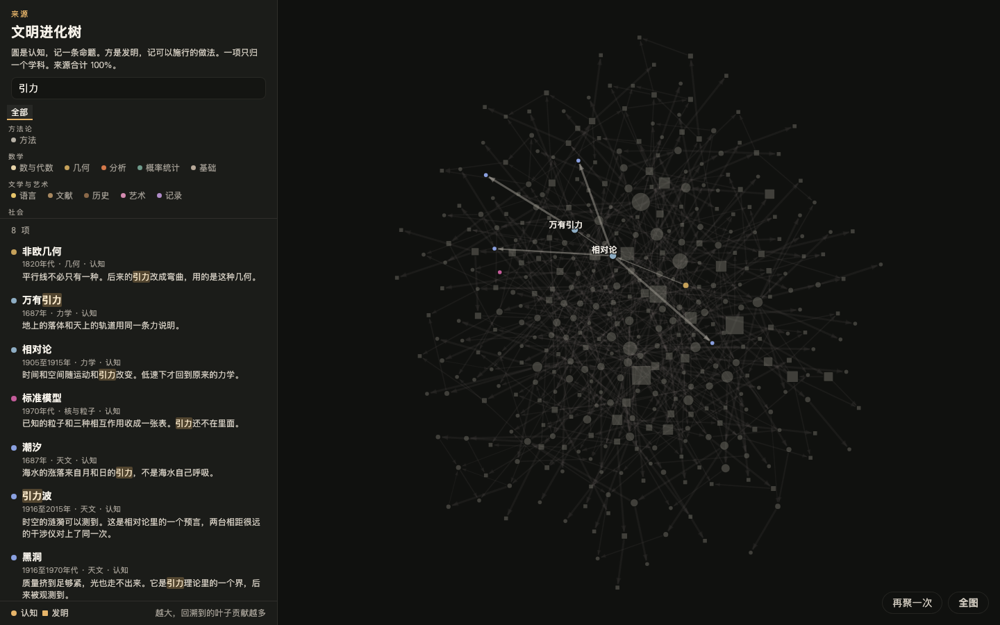
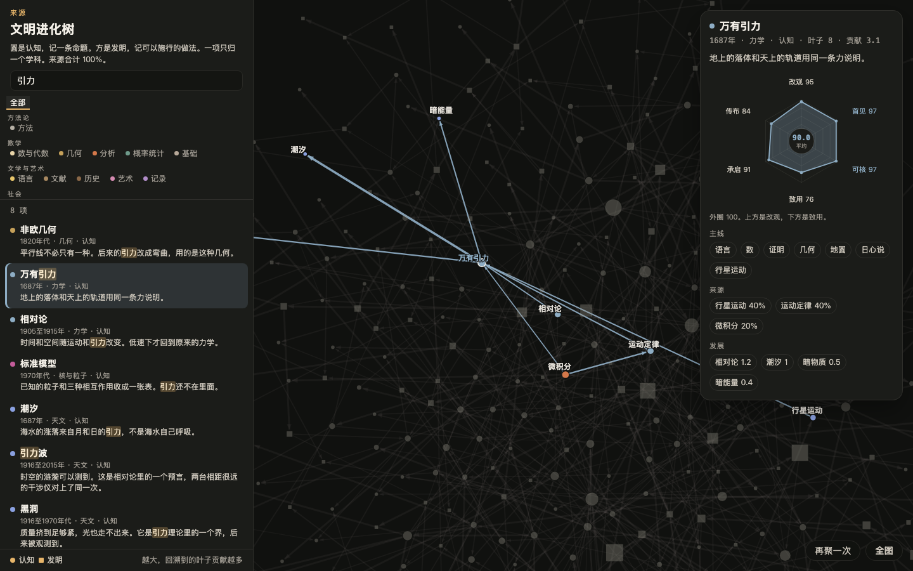

# 文明进化树

人类文明里的认知和发明，按承启关系画成一张可搜索的图。打开就能顺着一条做法，看到它借了哪些认识，以及后来长出了什么。

在线演示：<https://yidaibit.github.io/civilization-tree/>

图上有 384 项。圆是认知，记一条命题，共 211 条。方是发明，记可以施行的做法，共 173 项。一项只归一个学科。箭头从来源指向发展。数据里没有坐标，打开后有关系的互相拉近。

## 适合谁用

想把一条发明往上追到来源、再往下看到后续的人。也适合把科学史和技术史放在同一张学科图里浏览的人。

占比是编者对各项在组合里的份量判断。这张图不收录论文引用次数，不能当成引文网络来用。

## 总览

左边可以搜，也可以按学科收。学科分成六组：方法论、数学、文学与艺术、社会、生命、物理。颜色是学科。圆是认知，方是发明。点越大，回溯到的叶子贡献越多。右下角可以再按关系聚一次，或回到整张图。

## 怎么打开

在线直接打开上面的演示地址。

本地：

1. 克隆这个仓库。
2. 用浏览器打开 `index.html`。

页面是单个静态文件加上两份数据，不需要安装依赖，也不需要构建。

## 搜索

在左侧输入名称、介绍或学科。列表只留下匹配的项，并把关键词标出来。图上这些点保持原来的学科色，其余变暗。搜「引力」会留下非欧几何、万有引力、相对论、标准模型、潮汐、引力波、黑洞和引力透镜。

点左侧的学科，可以只看这一科。再点一次，或点「全部」，回到整张图。

## 点开一项

点左侧一行，或点图上的一个点，视图会移到它和紧邻的来源、发展。卡片里能看到：

- 年代、学科、叶子数和贡献。万有引力是 1687 年的力学认知，叶子 8，贡献 3.1。
- 一张六芒星。认知的六项从上方起顺时针是改观、首见、可核、致用、承启、传布。万有引力这六项是 95、97、97、76、91、84，平均 90.0。发明用另一组：改命、首创、效能、扩散、承启、普惠。外圈是 100。
- 主线。只沿主承启往上走。万有引力这条是语言、数、证明、几何、地圆、日心说、行星运动。
- 来源和发展。来源占比加起来是 100%。万有引力的来源是行星运动 40%、运动定律 40%、微积分 20%。

拖空白处平移，滚轮缩放。拖住一个点，周围会跟着松一松。双击空白，或点「全图」，回到整张图。按 `/` 聚焦搜索，按 Esc 取消选中。

## 数据在哪里

条目和承启关系写在 `grow.js`，六芒星分数写在 `stars.js`。位置在浏览器里现算，不上传搜索、点击或浏览记录。没有账号，也没有服务器端存储。

一项只归一个学科。和已有节点是同一件事的，不再另起一个点。收录范围、学科切法和占比的含义写在 `项目说明.md`。
